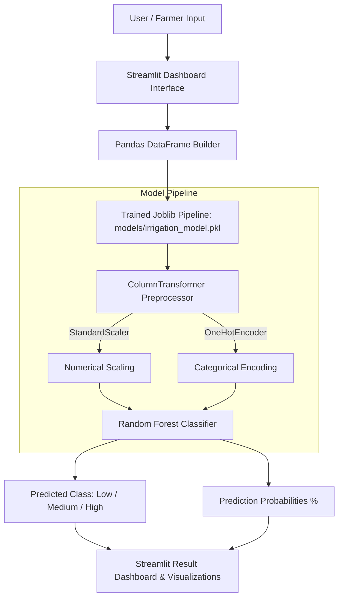

# 🌱 Smart Irrigation Water Requirement Prediction System

[](https://github.com/bhargavsarampati/Irrigation-water-prediction-)
[](https://www.python.org/)
[](https://streamlit.io/)
[](https://scikit-learn.org/)
[](https://github.com/bhargavsarampati/Irrigation-water-prediction-/graphs/commit-activity)
[](LICENSE)

An intelligent, data-driven machine learning application that predicts **agricultural irrigation water requirements** (`Low`, `Medium`, `High`) based on real-time soil, meteorological, crop, and farm management parameters. Designed to empower farmers and agricultural managers with precision irrigation schedules to conserve water and maximize crop yields.

---

## 📌 Table of Contents

- [Overview](#-overview)
- [Key Features](#-key-features)
- [System Architecture](#-system-architecture)
- [Dataset & Features](#-dataset--features)
- [Machine Learning Workflow](#-machine-learning-workflow)
  - [Algorithms Evaluated](#algorithms-evaluated)
  - [Model Performance](#model-performance)
- [Project Directory Structure](#-project-directory-structure)
- [Getting Started](#-getting-started)
  - [Prerequisites](#prerequisites)
  - [Local Installation](#local-installation)
  - [Running the Streamlit Application](#running-the-streamlit-application)
- [Using Docker / Dev Containers](#-using-docker--dev-containers)
- [Screenshots & UI Showcase](#-screenshots--ui-showcase)
- [Future Enhancements](#-future-enhancements)
- [Contributing](#-contributing)
- [Author & Acknowledgments](#-author--acknowledgments)

---

## 🌾 Overview

Water scarcity and unpredictable weather patterns make precision agriculture crucial. Over-irrigation leads to water waste, nutrient leaching, and root rot, while under-irrigation stunts crop growth and drastically reduces yields.

This project delivers an **end-to-end Machine Learning pipeline and Streamlit interactive web application** that accurately predicts the irrigation requirement level. By analyzing multiple soil attributes, atmospheric conditions, crop growth stages, and field specifications, the system outputs actionable irrigation recommendations with model confidence percentages.

---

## 🚀 Key Features

- **Multi-Factor Input Support**: Combines 19 distinct features across soil chemistry, real-time weather metrics, crop lifecycle, and farm management.
- **Trained Scikit-Learn Pipeline**: Fully packaged model pipeline incorporating automated preprocessing (`StandardScaler` for numeric values and `OneHotEncoder` for categorical factors) followed by an optimized `RandomForestClassifier`.
- **High Classification Accuracy**: Achieves **~97% test accuracy** on real-world multi-class irrigation requirements.
- **Probabilistic Confidence Scores**: Displays probability distributions across **Low**, **Medium**, and **High** water requirement categories with dynamic visual progress bars.
- **Interactive Web Interface**: Streamlit-based web dashboard offering intuitive sliders, dropdowns, and numerical inputs.
- **Cloud & Codespace Ready**: Pre-configured with `.devcontainer` configuration for instant launch on GitHub Codespaces or VS Code Remote Containers.

---

## 🏗️ System Architecture



---

## 📊 Dataset & Features

The model is trained on a comprehensive dataset of **10,000+ agricultural observation records** (`dataset/irrigation_prediction.csv`).

| Category | Features | Description |
|---|---|---|
| **🌍 Soil** | `Soil_Type` | Soil classification (Clay, Silt, Sandy, Loam, etc.) |
| | `Soil_pH` | Soil acidity / alkalinity level (0–14) |
| | `Soil_Moisture` | Volumetric soil water content (%) |
| | `Organic_Carbon` | Soil organic carbon percentage |
| | `Electrical_Conductivity` | Soil salinity metric (dS/m) |
| **🌤️ Weather** | `Temperature_C` | Ambient air temperature (°C) |
| | `Humidity` | Relative atmospheric humidity (%) |
| | `Rainfall_mm` | Precipitation amount (mm) |
| | `Sunlight_Hours` | Daily solar radiation exposure (hours) |
| | `Wind_Speed_kmh` | Wind speed velocity (km/h) |
| **🌾 Crop** | `Crop_Type` | Cultivated crop (Wheat, Rice, Maize, Cotton, etc.) |
| | `Crop_Growth_Stage` | Growth phase (Sowing, Vegetative, Flowering, Harvest) |
| | `Season` | Agricultural season (Kharif, Rabi, Zaid) |
| **💧 Farm & Irrigation** | `Irrigation_Type` | Method used (Drip, Sprinkler, Canal, Rainfed) |
| | `Water_Source` | Available source (Groundwater, Reservoir, River, Rainwater) |
| | `Field_Area_hectare` | Total cultivated area in hectares |
| | `Mulching_Used` | Mulch application (Yes / No) |
| | `Previous_Irrigation_mm` | Water depth applied in prior cycle (mm) |
| | `Region` | Geographic agricultural zone (North, South, East, West, Central) |
| **🎯 Target** | `Irrigation_Need` | **Low**, **Medium**, or **High** |

---

## 🧠 Machine Learning Workflow

The data science pipeline was researched and validated in [`irrigation_prediction.ipynb`](irrigation_prediction.ipynb):

1. **Exploratory Data Analysis (EDA)**: Distribution inspection, missing value verification, skewness correction, and correlation matrices.
2. **Feature Engineering & Preprocessing**:
   - Numeric features: Normalized with `StandardScaler`.
   - Categorical features: Encoded with `OneHotEncoder(handle_unknown="ignore")`.
   - Bundled together using `ColumnTransformer` to eliminate data leakage.
3. **Model Selection & Hyperparameter Tuning**:
   - Compared Logistic Regression, Decision Tree, and Random Forest architectures.
   - Tuned `RandomForestClassifier` with `n_estimators=200`, `max_depth=15`, and `min_samples_split=5`.
4. **Serialization**: Exported as a portable pipeline via `joblib` to [`models/irrigation_model.pkl`](models/irrigation_model.pkl).

### Algorithms Evaluated

| Model | Accuracy | Strengths |
|---|---|---|
| **Logistic Regression** | ~82.6% | Simple baseline, fast inference |
| **Decision Tree** | ~99.6% | High accuracy, prone to variance/overfitting |
| **Random Forest (Tuned)** 🏆 | **~97.0%** | **Optimal balance of high accuracy and robust generalization** |

### Classification Report (Tuned Random Forest)

```text
              precision    recall  f1-score   support

        High       1.00      0.40      0.57        67
         Low       0.98      1.00      0.99      1173
      Medium       0.95      0.97      0.96       760

    accuracy                           0.97      2000
   macro avg       0.98      0.79      0.84      2000
weighted avg       0.97      0.97      0.97      2000
```

---

## 📁 Project Directory Structure

```text
Irrigation-water-prediction-/
│
├── .devcontainer/
│   └── devcontainer.json          # Dev container & Codespaces environment definition
│
├── dataset/
│   └── irrigation_prediction.csv  # 10,000+ agricultural sample dataset
│
├── graphs/                        # Generated evaluation charts & visual assets
│   └── .gitkeep
│
├── models/
│   └── irrigation_model.pkl       # Serialized Scikit-Learn Random Forest Pipeline
│
├── app.py                         # Interactive Streamlit Web Application
├── irrigation_prediction.ipynb    # End-to-end Jupyter Notebook (EDA, training, evaluation)
├── prediction.py                  # Standalone model loading and verification script
├── requirements.txt               # Python package dependencies
└── README.md                      # Project documentation
```

---

## 💻 Getting Started

### Prerequisites

- **Python**: Version `3.10` or `3.11` recommended.
- **Git**: Installed and configured on your system.

### Local Installation

1. **Clone the repository**:
   ```bash
   git clone https://github.com/bhargavsarampati/Irrigation-water-prediction-.git
   cd Irrigation-water-prediction-
   ```

2. **Create and activate a virtual environment**:
   - **Linux / macOS**:
     ```bash
     python3 -m venv venv
     source venv/bin/activate
     ```
   - **Windows (Command Prompt / PowerShell)**:
     ```powershell
     python -m venv venv
     .\venv\Scripts\activate
     ```

3. **Install the dependencies**:
   ```bash
   pip install --upgrade pip
   pip install -r requirements.txt
   ```

### Running the Streamlit Application

Start the web application locally:

```bash
streamlit run app.py
```

Once started, open your web browser and navigate to:
```
http://localhost:8501
```

---

## 🐳 Using Docker / Dev Containers

This project includes a `.devcontainer` configuration for one-click setup in **GitHub Codespaces** or **VS Code Remote Containers**:

1. Click **Code > Open with Codespaces** on GitHub, or open the folder in VS Code with the *Remote - Containers* extension installed.
2. Select **Reopen in Container**.
3. All dependencies from `requirements.txt` will automatically install and port `8501` will forward the live preview.

---

## 🖥️ Streamlit App Preview & Inputs

The Streamlit UI provides categorized input sections:

- **🌍 Soil Information**: Soil Type selector, pH, Soil Moisture (%), Organic Carbon, Electrical Conductivity.
- **🌤️ Weather Information**: Ambient Temperature (°C), Humidity (%), Rainfall (mm), Sunlight Hours, Wind Speed (km/h).
- **🌾 Crop Information**: Crop Type, Growth Stage, Season.
- **💧 Irrigation Information**: Irrigation Type, Water Source, Field Area (hectare), Mulching Used, Previous Irrigation (mm), Region.
- **🔮 Prediction Output**:
  - Predicted irrigation requirement badge (`LOW`, `MEDIUM`, or `HIGH`).
  - Probability distribution table with percentage breakdown and visual progress bars.

---

## 🔮 Future Enhancements

- [ ] **Live IoT Sensor Integration**: Ingest real-time telemetry from soil moisture probes and automated weather stations.
- [ ] **Automated Weather API**: Connect to OpenWeatherMap or Tomorrow.io APIs for automated 7-day forecast predictions.
- [ ] **SMS / WhatsApp Alerts**: Automated alerts for farmers via Twilio or WhatsApp Business API.
- [ ] **Multi-Language Support**: Regional localization (Hindi, Telugu, Tamil, Marathi, Punjabi, etc.) to enhance accessibility for rural farming communities.
- [ ] **Edge Deployment**: Optimize models with ONNX Runtime for offline edge devices on farms.

---

## 🤝 Contributing

Contributions, issues, and feature requests are welcome!

1. Fork the Project (`https://github.com/bhargavsarampati/Irrigation-water-prediction-`)
2. Create your Feature Branch (`git checkout -b feature/AmazingFeature`)
3. Commit your Changes (`git commit -m 'Add some AmazingFeature'`)
4. Push to the Branch (`git push origin feature/AmazingFeature`)
5. Open a Pull Request

---

## 👤 Author & Acknowledgments

- **Bhargav Sarampati** - [GitHub Profile](https://github.com/bhargavsarampati)
- **Repository**: [Irrigation-water-prediction-](https://github.com/bhargavsarampati/Irrigation-water-prediction-)

---

<p align="center">
  <i>Made with 🌱 for precision agriculture and sustainable water conservation.</i>
</p>
